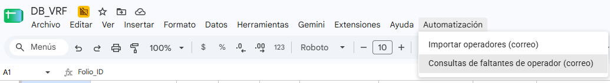

# 🔄 Operator Sync Automation

Automated HR operator roster sync and deduction query responses via Gmail and Google Sheets.



## 🎯 Problem Solved

HR teams in logistics companies send weekly Excel rosters by email and receive 30+ daily queries asking for operator deduction details. Both processes were handled manually:

- **Roster import**: downloading attachments, copy-pasting data, updating status — repeated weekly
- **Deduction queries**: reading each email, looking up the operator, writing a reply — 5 min each, 30+ times/day

This system automates both workflows end-to-end from a single Google Sheets menu.

## ⚡ Impact

| Metric | Value |
|--------|-------|
| Deduction queries automated | 30+ / day |
| Time freed per day | ~2.5 hours |
| False deactivations prevented | 0 (safety threshold active) |
| Manual data entry eliminated | 100% |

## 🏗️ Architecture

```
Gmail (HR email)
    │
    ▼
processOperatorEmails()
    ├── Download Excel attachment → Google Drive
    ├── Convert → Google Sheets (temporary)
    ├── Insert new operators (dedup by Employee ID)
    ├── Collect active IDs
    └── reconcileOperatorStatus()
            ├── Active IDs ≥ threshold → mark Active/Inactive
            └── Below threshold → alert email, skip reconciliation

Gmail (HR deduction query)
    │
    ▼
checkOperatorDeductions()
    ├── Extract operator name from subject/body
    ├── Look up deduction records in sheet
    ├── Build HTML summary table
    └── replyAll() preserving original CC recipients
```

## 📁 File Structure

```
operator-sync-automation/
├── src/
│   ├── Menu.gs            ← Custom Sheets menu
│   ├── OperatorSync.gs    ← Main workflows
│   └── Utils.gs           ← Name normalization, email parsing
├── docs/
│   └── images/
│       └── menu-preview.png
├── config.example.gs      ← Configuration template
├── README.md
└── LICENSE
```

## 🚀 Setup

### Prerequisites

- Google Workspace account (or personal Google account with Gmail + Drive)
- Google Sheets spreadsheet with two tabs:
  - `operators_catalog` — columns: `Operator_ID`, `Operator_Name`, `Position`, `Role`, `Status`
  - `operator_missing_items` — columns: `Operator_Name`, `Movement_Type`, `Deduction_Concept`, `Total_Amount`, `Installments`
- Advanced Drive API enabled in Apps Script

### Installation

1. Open your Google Sheet → **Extensions → Apps Script**

2. Create the following files and paste the contents from `src/`:
   - `Menu.gs`
   - `OperatorSync.gs`
   - `Utils.gs`

3. Create `config.gs` based on `config.example.gs` and fill in your values:

```javascript
const HR_SENDER_EMAIL    = "hr@yourcompany.com";
const DRIVE_FOLDER_ID    = "YOUR_FOLDER_ID";
const ALERTS_EMAIL       = "you@yourcompany.com";
// ... see config.example.gs for full list
```

4. Enable **Drive API** under Services → Add a service → Drive API

5. Save and reload the spreadsheet — the **Automation** menu will appear

6. *(Optional)* Set up a time-based trigger to run `processOperatorEmails()` automatically (recommended: daily)

## ⚙️ Configuration Reference

| Variable | Description |
|----------|-------------|
| `HR_SENDER_EMAIL` | Email that sends weekly roster attachments |
| `HR_EMAIL_SUBJECT` | Subject keyword to identify roster emails |
| `DEDUCTION_SENDERS` | Array of emails that send deduction queries |
| `ALERTS_EMAIL` | Your email for notifications and auto-replies |
| `DRIVE_FOLDER_ID` | Google Drive folder ID for Excel storage |
| `OPERATORS_SHEET_NAME` | Sheet tab name for operator catalog |
| `DEDUCTIONS_SHEET_NAME` | Sheet tab name for deduction records |
| `HR_EXCEL_SHEETS` | Tab names inside the HR Excel attachments |
| `MIN_ACTIVE_IDS_THRESHOLD` | Safety minimum to trigger reconciliation |

## 🛡️ Safety Features

**Reconciliation threshold** — If the HR file contains fewer active IDs than `MIN_ACTIVE_IDS_THRESHOLD`, status reconciliation is skipped and an alert email is sent. Prevents mass-deactivation from incomplete files.

**Duplicate detection** — Operators are matched by Employee ID before insertion. No duplicate rows are created even if the same file is processed twice.

**CC preservation** — Auto-replies include all original recipients from the first message in the thread, maintaining the communication chain.

## 🔧 Tech Stack

- Google Apps Script
- Gmail API
- Google Drive API
- Google Sheets

## 📄 License

MIT — see [LICENSE](LICENSE)

## 👤 Author

Eduardo Cruz · [GitHub](https://github.com/eddcruz) · [LinkedIn](https://www.linkedin.com/in/eduardo-alejandro-cruz-castillo-a540b115a)