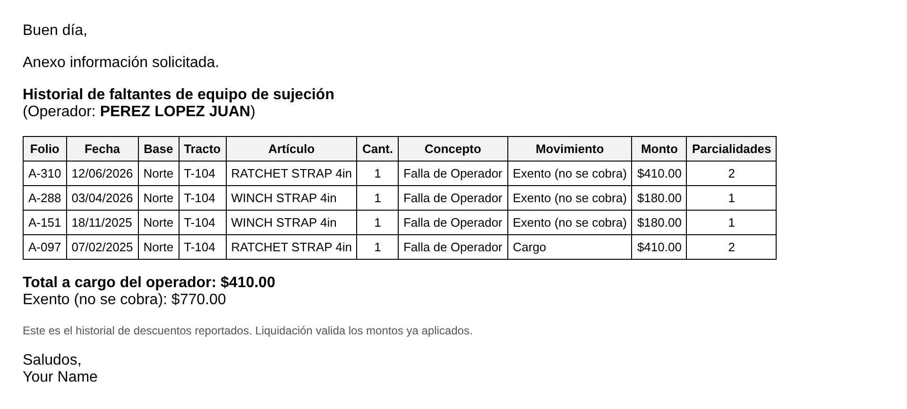
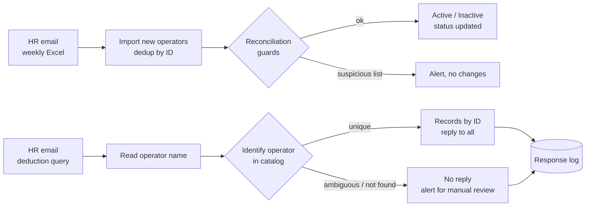

# Operator Sync Automation

Google Apps Script automation running in production at a logistics company: it keeps the operator roster in sync with HR's weekly list and answers HR's deduction queries by email — safely.



## Problem

Two manual, repetitive processes between HR and operations:

- **Weekly roster:** HR emails an Excel file with the active operators. Someone had to download it, copy new operators into the catalog and mark who left.
- **Deduction queries:** before paying a final settlement, HR emails asking for an operator's equipment deductions. 30+ queries a day, each answered by hand: find the operator, add up the records, reply to everyone.

## Impact

| Metric | Value |
|---|---|
| Deduction queries answered automatically | 30+ per day |
| Time freed | ~2.5 hours per day |
| Typical reply time | under 5 minutes |
| Manual roster data entry | eliminated |

## How it works



## Safety by design

A wrong automatic reply means an operator is charged incorrectly, so the system prefers **not answering** over **answering wrong**:

- **Identifies operators by ID, not by name.** The name in the email is matched against the catalog (accents, case and word order ignored) to get the operator ID; records are then pulled by ID.
- **Namesakes:** if two operators share a name, the base mentioned in the email breaks the tie. If it is still ambiguous, it does **not** reply and sends an alert with the candidates.
- **"No deductions" only when certain.** An incomplete or misspelled name never produces a "no deductions" reply; it goes to manual review.
- **Exempt items are never added to the amount charged.** The reply shows the charge total and the exempt amount separately.
- **Answered threads are never answered twice**, even when new messages arrive in the same thread.
- **Roster guards:** reconciliation is skipped (with an alert) if the HR list has fewer than 20 IDs, or if it would deactivate more than 10% of active operators at once — the typical sign of an incomplete file.
- **Test mode:** with `MODO_PRUEBA: true`, every reply goes only to the owner, marked `[PRUEBA]`, before switching to production.
- **Response log:** every reply or review case is written to a sheet (operator ID, method, records, amounts).

### Lesson learned

The first version summed every movement into one total, including exempt items, so a reply could overstate the amount to deduct. Version 2 fixed the calculation, added the ID-based matching and guards above, and covered each rule with automated tests.

## Project structure

```
operator-sync-automation/
├── src/
│   ├── Automatizacion_Menu.gs   # Custom menu in Google Sheets
│   ├── Procesos_Operadores.gs   # Roster import, reconciliation, query replies
│   └── Utilidades_Comunes.gs    # Name normalization, HTML, dates, money
├── Config.example.gs            # Template: every company-specific value lives here
├── tests/run-tests.js           # 19 tests of the pure logic (fictitious data)
└── .github/workflows/tests.yml  # Runs the tests on every push
```

The code in `src/` is **identical** to the production code. Everything company-specific (emails, folder IDs, sheet and tab names, bases) lives in `Config.gs`, which is never committed. Code comments are in Spanish because the system runs in a Spanish-speaking operation.

## Setup

1. Open your Google Sheet → **Extensions → Apps Script**.
2. Create the three files from `src/` and paste their contents.
3. Create a file named `Config`, paste `Config.example.gs` and fill in your values. Keep `MODO_PRUEBA: true`.
4. **Services → Drive API** → Add.
5. Reload the sheet: the **Automatización** menu appears.
6. Triggers: `revisarFaltantesOperador` every 5 minutes; `procesarCorreosOperadores` weekly.
7. Run `probarRespuestaFaltantes` (sends a reply only to you), review a few `[PRUEBA]` replies, then set `MODO_PRUEBA: false`.

## Tests

```bash
node tests/run-tests.js
```

The tests load `Config.example.gs` and `src/` and check the rules that matter: name matching, namesakes, "no deductions" only when certain, exempt items excluded from totals, and the reconciliation guard.

## Release process

`src/` is developed and tested here. To release, the three `src/` files are copied into the production Apps Script project; `Config.gs` is never touched, so no company data enters this repository.

## Tech stack

Google Apps Script (V8) · Gmail · Google Drive API · Google Sheets · Node.js (tests) · GitHub Actions

## License

MIT — see [LICENSE](LICENSE)

## Author

Eduardo Cruz · [GitHub](https://github.com/eddcruz) · [LinkedIn](https://www.linkedin.com/in/eduardo-alejandro-cruz-castillo-a540b115a)
